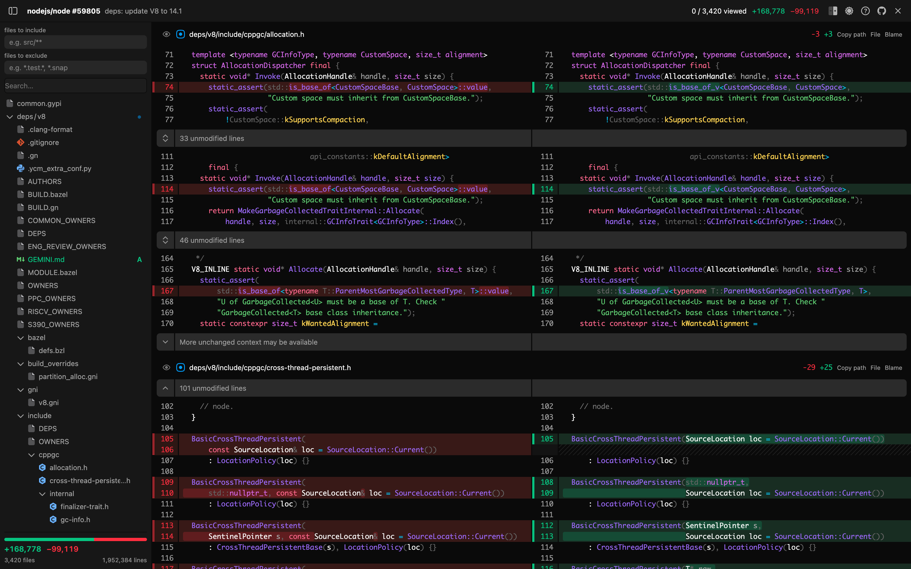
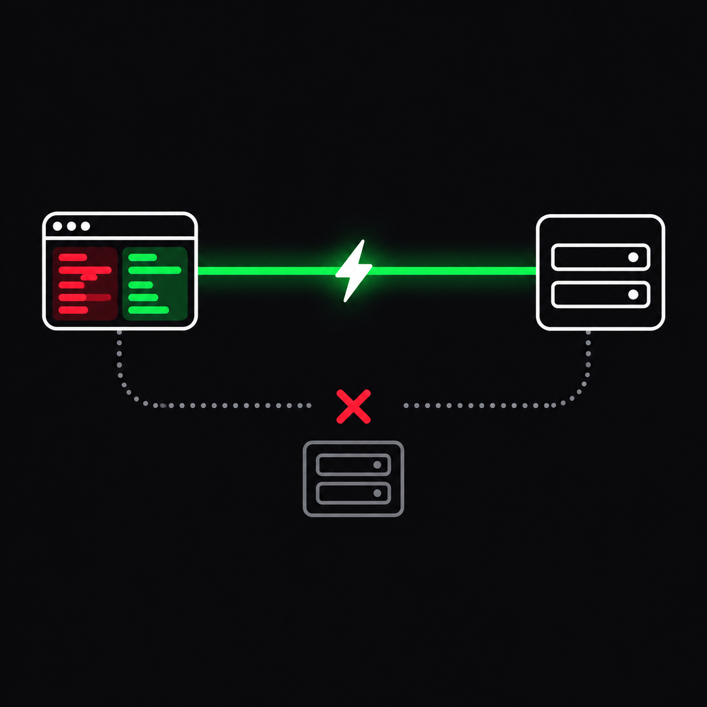
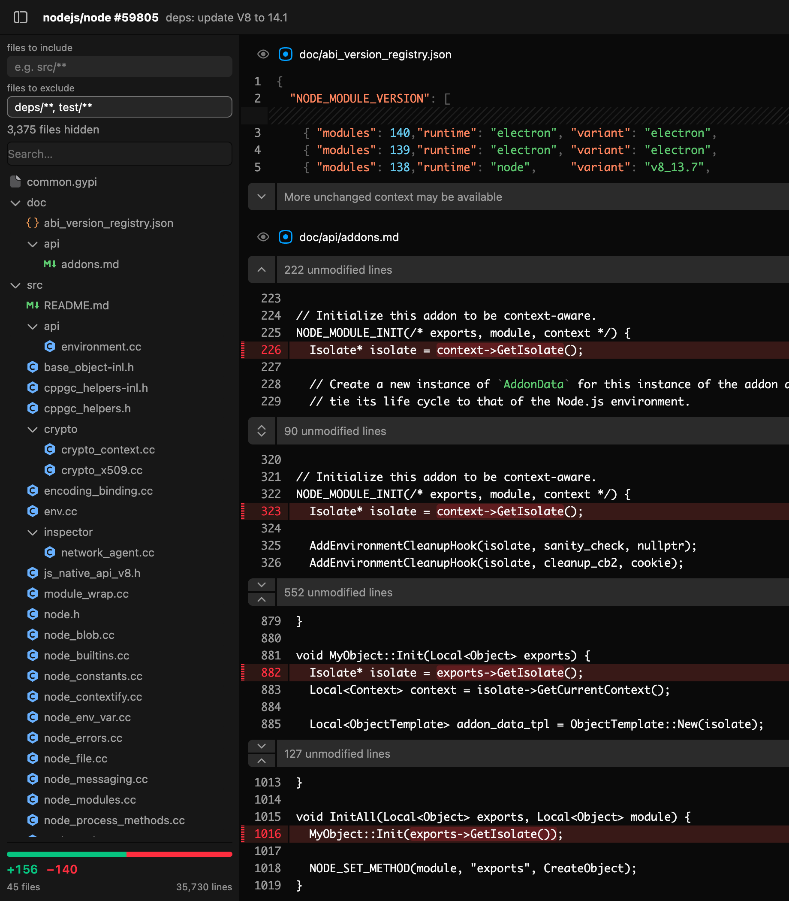
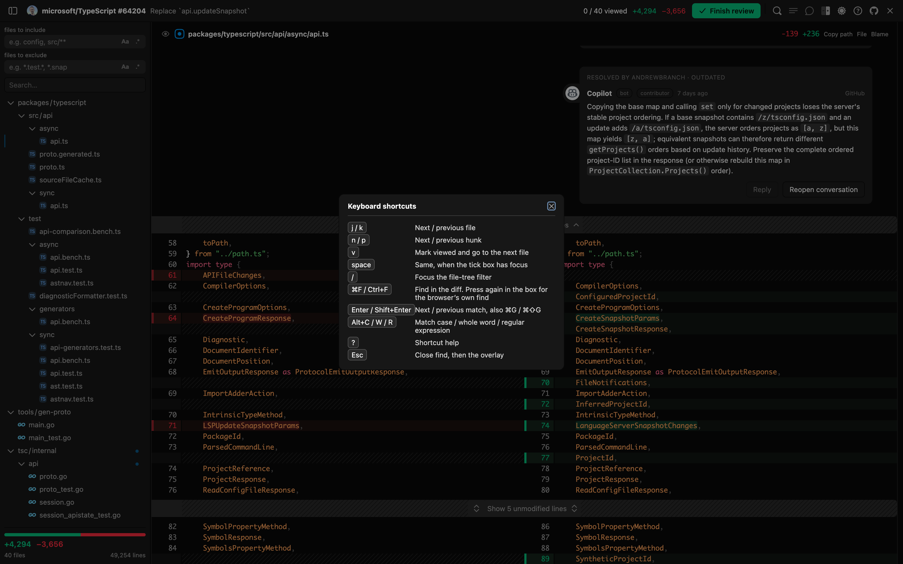
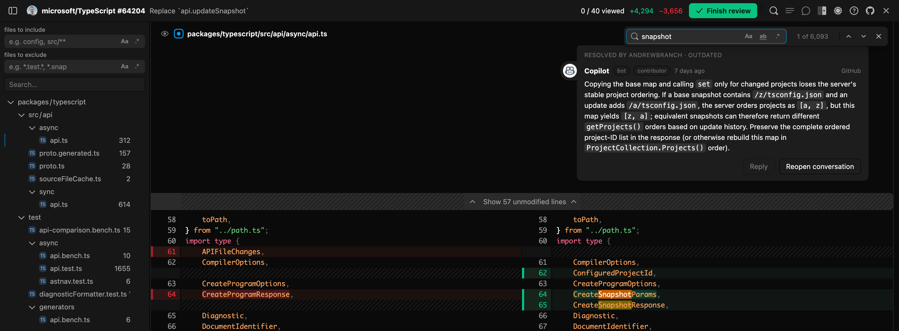
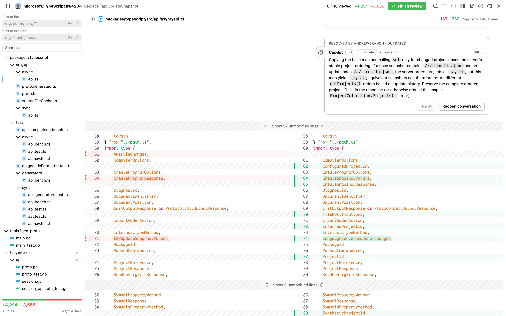

# DiffsHub for GitHub

Review a GitHub pull request without waiting for it to render.

Click "Files changed" and the diff opens in a fullscreen viewer built on
Pierre's [`@pierre/diffs`](https://diffs.com), the open-source components
behind [diffshub.com](https://diffshub.com). In it, a 3,420-file pull request
scrolls at 120 fps with no frame over 50 ms. In GitHub's own tab, one frame in
three takes longer than that.

The whole review happens in it: read the diff, tick files off, comment on a
line, reply, resolve a conversation, approve or ask for changes. Everything goes
to github.com from your own browser, signed in as you already are. No token to
paste, no other server, nothing about the code leaves your machine.

For Chrome and Firefox 147 or later.



## How you open it

The extension puts its icon on the "Files changed" tab. Click the icon and the
viewer opens instead of GitHub's own diff, which GitHub then never renders.
Most of the speed comes from not rendering it. The toolbar button opens it too.


The rest of the tab still opens GitHub's own view. `Esc` closes the
viewer and puts you back where you were: no navigation, no history entry, and
the URL never changes.

## Nothing leaves your browser



diffshub.com already renders GitHub diffs far faster than GitHub does. To use it
you copy a URL, swap the host, and read the diff on a site that is not GitHub.
For a private repository you also paste a GitHub token into that site.

This extension gives you the same viewer inside the GitHub tab. There is no URL
to rewrite, and every request goes to github.com from your own browser, as you.

No token is stored, no other host is contacted, and no diff content leaves the
machine.

## Speed

Scrolling `nodejs/node#59805`, 3,420 files and 1.95M lines, over 180 frames,
measured in September 2026:

| | Median frame | p95 | Worst | Frames over 50 ms |
| --- | --- | --- | --- | --- |
| This viewer | 8.3 ms (120 fps) | 10.3 ms | 20 ms | 0 / 180 |
| GitHub's Files changed | 12.3 ms (81 fps) | 98.6 ms | 157 ms | 59 / 180 |

`pnpm test:fps` measures both. GitHub's own numbers move
from run to run: of three runs, its frames over 50 ms ranged from 51 to 61.

The first file is readable long before the download ends, and only the lines
on screen are drawn, so the page stays light however large the pull request.

## In the viewer

**A file tree you can cut down.** Two fields, one to include and one to
exclude, with a count of what they hide. Generated code and snapshots stop
getting in the way. The viewer remembers the patterns for the next pull request.

Each field reads what you type the way you meant it. Plain words match anywhere
in the path, so `config` finds `src/ConfigFile.ts`; anything written like a glob
stays a glob, so `src/**` and `*.test.*` mean what they always have. Two
switches on each field, as in a code editor: **Aa** for case, **.\*** for
regular expressions. A clear button appears once there is something to clear,
and `Esc` does the same. A faint bar beside the tree marks the files on screen
and moves as you scroll.



Here `**/test/**, tools/**` takes a 40-file pull request down to 27.

**Keys that match GitHub's.** `j` and `k` move between files, `n` and `p`
between changes in a file, `v` ticks a file off and moves to the next one, `/`
jumps to the tree filter, `?` shows the list, `Esc` closes the viewer. They
work the moment the viewer opens, with no click into it first.



**Find across the whole diff.** The browser's own find sees only the lines on
screen, which on a long diff is almost nothing. `⌘F` (`Ctrl+F`) opens a find
bar that searches every changed file instead: matches marked in the code and
counted per file in the tree, `Enter` to step through them, and the same
**Aa** and **.\*** switches plus whole word. It searches what is already loaded,
including lines you expanded, and downloads nothing. Press `⌘F` again in the
box for the browser's own find.



**Your theme.** The viewer opens in GitHub's theme, including the dimmed,
high-contrast and colourblind variants, and a toolbar button switches light and
dark on the spot. Light uses VS Code's own default, whose tokens meet the
contrast WCAG asks for, bar one.



**A whole review, without leaving.** Every conversation on the pull request is
shown at the line it was written against, including the outdated ones GitHub's
own page drops. Comment on a line, reply to a thread, resolve or reopen it, edit
or delete your own comments, and finish with a verdict: approve, request
changes, or comment. Approving can also tick off the files still on show. The
comment box is GitHub's own formatting toolbar and markdown preview, so what you
see is what gets posted. A toolbar button hides the conversations when you only
want to read.

**Reading a pull request twice is cheap.** The viewer keeps the patch in
memory until the browser closes, keyed on the commit, so a reload or a trip to
another page and back does not download it again; a push does. The patch is
never written to disk. Your preferences stay in the viewer's own localStorage.
See [`docs/caching.md`](docs/caching.md).

**The rest.** Split and unified layouts. Collapsed lines expand in place. Copy
path, open the file, and blame, per file. Hiding files that changed only in
spacing. Ticking a file off as viewed marks it in the tree, and marks the folder
once all of it is read. A short message when GitHub answers something the
viewer did not expect, naming what broke, while the diff keeps rendering.

## What is not built

- **Ignoring whitespace line by line.** A file that changed only in spacing can
  be hidden whole, but a file mixing a reformatting with a real edit shows
  both. Hiding the individual lines would renumber what is left, and a comment
  anchored to a renumbered line is a comment on the wrong code.
- **Applying a suggested change.** Suggestions render as GitHub renders them,
  but the Commit button is still on GitHub.
- **Batching a review.** A comment written here is posted as it is written,
  the way a single comment is on GitHub, rather than held back until the
  review is submitted.

## Reading further

- [`docs/capabilities.md`](docs/capabilities.md) everything it takes to replace
  GitHub's review page, and where each piece stands. Every must-have is built
- [`docs/lifecycle.md`](docs/lifecycle.md) what happens, in order, from the
  click to the first file, and what closing does
- [`docs/caching.md`](docs/caching.md) what is kept and where, what a push does
  to it, and the measured limits
- [`docs/firefox.md`](docs/firefox.md) what Firefox does differently, and the
  traps
- [`research/github-internal-api/`](research/github-internal-api/) the
  undocumented API this extension runs on, read out of GitHub's own published
  sourcemaps. As far as we can tell, nobody else has written it down
- [`docs/upstream.md`](docs/upstream.md) where this works around Pierre's
  libraries, and what would let it stop
- [`docs/analysis.md`](docs/analysis.md) how diffshub.com works, read from its
  own source in the submodule
- [`docs/todo.md`](docs/todo.md) open items, each with enough detail to pick up
  cold

## Working on it

Start with [`AGENTS.md`](AGENTS.md): how the code is split, the commands, and
what to know before changing anything.

### Getting started

Node.js 22.18 or newer, and pnpm 10. The tests import TypeScript straight
from `src/`, which Node runs without a build step from 22.18 on.

```sh
pnpm install
pnpm dev             # Chrome, with hot reload
pnpm dev:firefox     # Firefox
```

`pnpm dev` starts [WXT](https://wxt.dev), which builds the extension and opens a
browser with it already loaded. `pnpm dev:firefox` rebuilds on every change and
reloads the add-on instead, because Firefox will not run an extension page from
a dev server; reload the page to see the change.
[docs/firefox.md](docs/firefox.md) has the why.

### Building

```sh
pnpm build           # -> .output/chrome-mv3
pnpm build:firefox   # -> .output/firefox-mv3
pnpm zip             # packaged for the Chrome Web Store
pnpm zip:firefox     # packaged for addons.mozilla.org
```

To load a build by hand: in Chrome, open `chrome://extensions`, turn on
Developer mode, and pick `.output/chrome-mv3` under "Load unpacked". In Firefox,
open `about:debugging`, choose "This Firefox", and load
`.output/firefox-mv3/manifest.json` as a temporary add-on.

### Testing

The suites drive a real browser with the real extension loaded. `pnpm test`
replays a recording of github.com, so it runs offline; the others go live.
Build first, and record once with `pnpm test:record`.

```sh
pnpm build && pnpm test   # the viewer, replayed from a recording: offline, no GitHub
pnpm test:live            # the same, against real github.com
pnpm test:record          # refresh the recording
pnpm test:review          # comments, replies, verdicts and viewed state: these write
pnpm test:firefox         # that the Firefox fetch path is still needed, and works
pnpm test:whitespace      # hiding files that changed only in spacing
pnpm test:units           # offline, no browser
pnpm test:fps             # frame times, against GitHub's own view
pnpm capture:readme       # the screenshots above, into docs/images
pnpm lint                 # oxlint, with every no-comment-slop rule on
pnpm format               # oxfmt, Prettier's options (see .oxfmtrc.json)
```

The recording is made signed out, against a public pull request, with the
credential headers stripped, and it is gitignored. `pnpm test:live` catches
GitHub changing under it. `pnpm test:review` posts comments and submits
reviews, so it runs against a pull request kept for the purpose; pass another
as an argument for a different one.

The browser tests keep a profile in `test/.profile`, gitignored, and `pnpm
test:login` opens a browser on it so you can sign in once; after that private
repositories are testable too. `DIFFSHUB_PROFILE` points at another profile.
`pnpm test:firefox` needs `pnpm build:firefox` and `DIFFSHUB_FIREFOX_PROFILE`, a
Firefox profile signed in by hand ([docs/firefox.md](docs/firefox.md)). None of
this runs in CI.

### Layout

The source is laid out by where the code runs, because that decides what each
part is allowed to do. `AGENTS.md` has the reasoning.

```
src/shared/                   what both sides share: the messages between
                              them, which pull request, which URLs to trust
src/background/               the background script: fetches for Firefox and the
                              in-memory cache, for the viewer only
src/page/                     runs on github.com, as you: every write, and
                              everything read out of GitHub's own markup
src/viewer/                   runs on the extension's own origin
  state/                      what the viewer knows, and loading the patch
  net/                        fetching file contents in both browsers
  bridge/                     asking the page to read or write
  diff/                       the diff view, its styling and its workers
  tree/                       the file tree, its filters and what is on screen
  comments/                   conversations, and the box for a new one
  review/                     the verdict, and which files are read
  find/                       find in the diff, and its marks
  shell/                      the frame: toolbar, toasts, dialogs, shortcuts
src/patch/                    a .diff becomes files, hunks and filters,
                              and is packed for the cache
src/entrypoints/              WXT's entry points, kept thin
public/                       files copied as-is
scripts/                      one-off helpers for development
docs/                         capabilities, Firefox, open items, README images
test/                         the browser suites and the offline checks
research/github-internal-api  what GitHub's undocumented API does
research/pierre               git submodule, read-only reference (see below)
```

### Research submodule

`research/pierre` is a shallow clone of
[pierrecomputer/pierre](https://github.com/pierrecomputer/pierre), the Apache-2.0
monorepo that holds `@pierre/diffs`, `@pierre/trees`, and the source of
diffshub.com itself (`apps/diffshub`). It is there to read, not to build
against: the extension depends on the published npm packages.

```sh
git clone --recurse-submodules <this repo>
# or, in an existing clone
git submodule update --init --depth 1
```

## Licence

MIT, Copyright (c) 2026 Jan Nicklas. See [LICENSE](LICENSE).

The build bundles the Pierre packages (`@pierre/diffs`, `@pierre/trees`,
`@pierre/icons`, `@pierre/theme`, `@pierre/theming`), which are Copyright 2025
Pierre Computer Company under the Apache License, Version 2.0. Their terms and
the full licence text are in [THIRD-PARTY-NOTICES.md](THIRD-PARTY-NOTICES.md).
