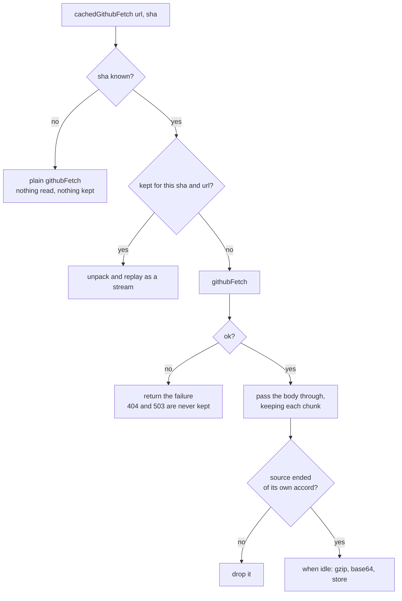

# Caching

What is kept, where, and why a stale diff is not served.

## Why

One open of a forty-file pull request costs about 986 KB, and **740 KB of that
is the patch**, from `patch-diff.githubusercontent.com`, the one host that
answers 503 under load. Closing the overlay only hides the iframe, so reopening
is already free; a reload, a restored tab or GitHub's own navigation to another
pull request and back is not. The patch is a pure function of the commit, so a
copy keyed on the head sha takes most of that traffic away.

## What happens on a request



The body passes through a transform rather than being split, so the parser is
the only thing pulling on github.com. A split stream pulls its source whenever
either half pulls, and a half read flat out would take the whole download while
the parser worked a few files a turn.

The same transform decides what finished means. Its `flush` runs only when the
source ends of its own accord: a body that stops short errors the stream, a
reader giving up cancels it, and neither can leave half a patch to be served
as the whole. On Firefox the patch arrives over a port from the background,
which treats a disconnect before `end` as an error for the same reason.

## Where it is kept

`storage.session`: in memory, shared across tabs, gone when the browser closes.
Never `storage.local` or the Cache API, which would put private diffs on disk.

The background holds it in both browsers and the viewer asks over
`runtime.sendMessage`. Firefox would leave no choice, since it withholds
`browser.storage` from a viewer framed by github.com; Chrome's viewer has the
api, but one route means the Chrome suite runs the path Firefox uses. What
crosses is a string: Chrome's messaging is json, and bytes would not survive
it.

## Staleness

The key is the head sha, read from markup GitHub already embedded and passed to
the viewer on the iframe's url, so it is there before the download starts. A
page on a newer commit asks a different key and downloads. Without a sha the
cache is off.

The sha is the one the page loaded with, not what the server answers now: a tab
left open across a push downloads the new diff and keeps it under the old key.
Reloading the pull request page corrects it. The uncached viewer shows the same
thing in that state; the cache only makes it last.

## Limits

Stored compressed, 5.6 times smaller than the patch once base64 is paid for.
`storage.session` refuses a value past 10,485,760 bytes, and the cache keeps
under 8 MB of it. Before a write that would cross that it clears itself and
starts again, rather than keeping an index to evict the oldest entry. The usage
is counted before writing, so the bound holds whether or not the browser
enforces its quota.

## Not cached

- **Comments.** They change without a commit, and travel the content script's
  route.
- **Binary blobs** and **raw files for hunk expansion.** Blobs are unbounded,
  and dozens of small raw files would clear out the patch, which is the one
  entry worth keeping.
- **Anything that is not `ok`**, and anything that did not finish.

## Watching it

A development build logs each decision to the viewer's console. A built one
does after this, run in the viewer frame's console:

```js
localStorage.setItem('diffshub-for-github.debug', 'on');
```

## What it does not fix

A cold 503. Nothing is kept for a commit that was never read, and nothing in
the extension retries a refused request. See [todo.md](todo.md).
