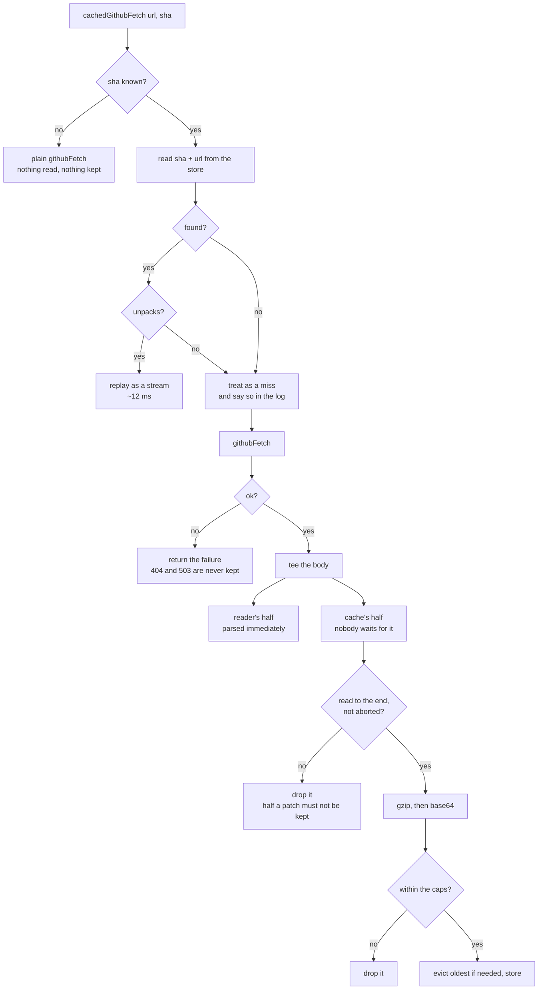
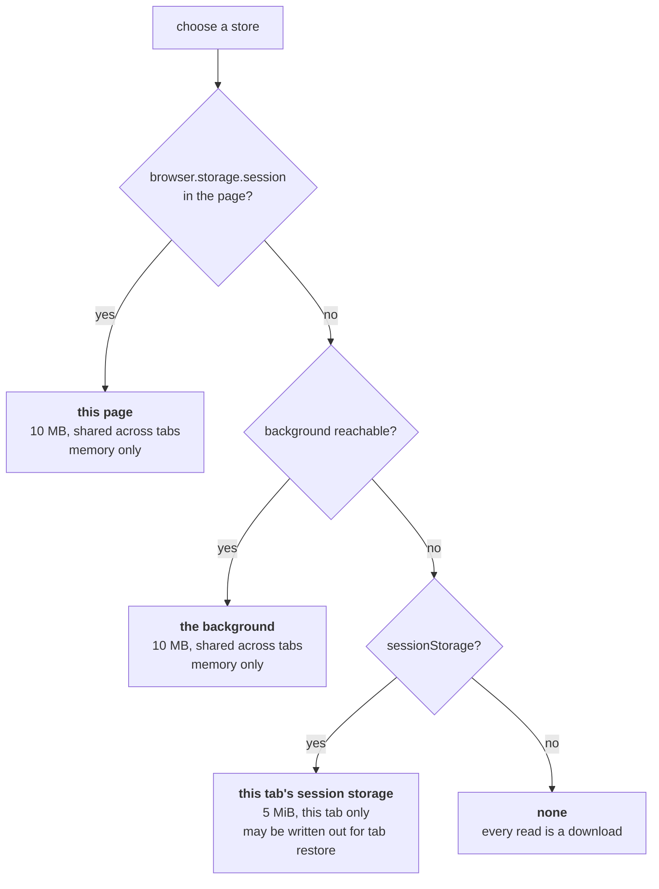

# Caching

What is kept, where, and what can never be served stale. Every number here was
measured in a browser, not read off a spec.

## Why

One overlay open on `microsoft/TypeScript#64204` costs eight requests and about
986 KB, and **740 KB of that is the patch** — from
`patch-diff.githubusercontent.com`, the one host that answers 503 under load.

Nothing used to survive a reload. Closing the overlay is free because the content
script hides the iframe for five minutes rather than destroying it
(`src/entrypoints/content.ts:36`), but a real teardown — F5, a restored tab,
GitHub's own navigation to another pull request and back — threw everything away
and asked again.

The patch is a pure function of the commit, so keying a copy on the head sha
removes most of that traffic, and removes it from the host least able to serve
it.

## What happens on a request



The split is what lets the reader start immediately: its half is parsed as it
arrives while the copy is taken behind it, awaited by nobody.

It is not free, though. A split stream pulls its source whenever **either** half
pulls, so the half being packed — which reads as fast as it can — drains the
network at full speed while the parser works to an 8 ms budget, and everything
the parser has not reached yet queues up in memory. Measured with a slow reader:
190 of 200 chunks waiting. On a 20 MB patch that is tens of megabytes held, and
the compression runs on the main thread while the diff is still drawing. See
[todo.md](todo.md).

## Where it is kept

The viewer is an extension page, but on Firefox it is one framed by github.com,
and there `browser.storage` is withheld from it — the same shape of restriction
that partitions its cookie jar and makes `githubFetch` proxy through the
background. So the store is chosen at runtime, best first.



Chrome takes the first. Firefox takes the second, confirmed in a built add-on:
its framed viewer reports no `browser.storage` at all, and the log there reads
`keeping what github.com answers in the background`. The third exists so a viewer refused both still caches something, and it
is the only one that can reach the disk — a browser may write session storage out
to restore your tabs.

What crosses to the background is the packed **string**, never bytes. Chrome's
`postMessage` is JSON, and a `Uint8Array` round-trips through it as
`{"0":31,"1":139}` — the same trap that stops the Firefox fetch proxy being
reused on Chrome.

## Staleness

The head sha is part of the key, and it is read from the page that is open now —
`readHeadSha()` (`src/page/pageInfo.ts:75`) is a regex over markup GitHub already
embedded, so it costs no request. It travels on the iframe's url so the viewer
has it at its **first render**, before the patch starts downloading.

A page on a newer commit therefore asks a different key, misses, and downloads.

**The guarantee is exactly as strong as that sha is fresh, and no stronger.** It
is the commit the *page believed* at load, not the one the server answers with:
`/pull/N.diff` returns whatever is at the head when it is asked. Leave a tab open
at commit X, let someone push Y, open the overlay — the markup still says X, the
download is Y's diff, and it is stored under X. Without the cache that same page
shows the same wrong diff; what the cache adds is that it persists. Reload the
pull request page and it corrects itself.

Where the sha is unknown the cache is off entirely, read and write. A key that is
not the commit is a key that can hand back the wrong diff.

**A push while the viewer is open is noticed but not applied.** The content
script re-reads the sha on `visibilitychange` — a DOM read, no request — and the
viewer offers a reload rather than swapping the diff out from under a reader
mid-review. The viewer keeps two shas for this: the one it is *showing*, which
moves only when asked, and the one the page *has*, for comparison.

## Limits

Compressed, because a real patch gzips 7.5× and base64 gives a third of that
back — measured at **5.6× net**, 757,775 characters of diff stored as 135,036.

| | extension store | page session storage |
| --- | --- | --- |
| ceiling | 10,485,760 bytes, enforced | 5 MiB, and not part of the quota system |
| per entry | 6 MB ≈ 33 MB of diff | 3 MB ≈ 17 MB of diff |
| total | 8 MB ≈ 45 MB of diff | 4 MB ≈ 22 MB of diff |
| entries | 24 | 12 |

`storage.session`'s ceiling was measured, not quoted: a 9 MB value stores and
reads back, a 10 MB one is refused outright with nothing written. Web storage is
excluded from that quota system and has its own hard 5 MiB an origin.

Eviction is least-recently-read first. Every failure is silent — a blocked area,
a full quota, a value from an older version — because this is an optimisation and
must never be able to fail a render.

## Not cached

- **Comments** (`page_data/threads`, `thread_previews`). They change without a
  commit, so no commit key could make them safe. They also travel the content
  script's route, not this one.
- **Binary blobs** (`BinaryCompare`). Unbounded, and it reads `Content-Length`
  and cancels the body rather than downloading it anyway.
- **Raw files for hunk expansion** (`fileLoader`). A few kilobytes each and
  dozens of them, so on one shared budget they evict the patch — the one entry
  worth keeping. `createFileLoader` has its own in-memory map, and the overlay
  is held for five minutes after closing, which covers them.
- **Anything that is not `ok`.** A 404 from a lapsed session or a 503 from a busy
  host must be asked again, not remembered for the session.
- **A body that did not finish** — as far as the transport can tell. GitHub
  sends the patch gzipped with no length, so there is no count to check against.
  Gzip's own trailer does **not** save you: Chrome's decoder skips the footer and
  ends a truncated gzip body cleanly. What actually protects a real download is
  HTTP/2's end-of-stream, which a dropped connection does not fake. On Firefox
  the patch arrives over a port from the background, and there a disconnect
  mid-download is treated as an error rather than an end
  (`githubFetch.ts`) — without that, a background event page going away halfway
  would store the first few files as the whole diff.

## Watching it work

Off in a built extension, because nothing else here writes to a reader's console.
In the **viewer's** console:

```js
localStorage.setItem('diffshub-for-github.debug', 'on');
```

```
DiffsHub: keeping what github.com answers in this page
DiffsHub: 2.diff fetched from github.com
DiffsHub: 2.diff kept, 1 KB of diff as 1 KB
```

and on the next reload:

```
DiffsHub: 2.diff reused from the cache, 1 KB stored
```

A development build logs without the setting.

## What this does not fix

The cache cannot help a **cold** 503. Nothing is stored for a commit not yet read
successfully, so the first fetch is fully exposed, and there is no retry or
backoff anywhere in the extension — the pacing and refusal detection built for
the test harness has no counterpart in the product. See `docs/todo.md`.

## Where it lives

| file | what |
| --- | --- |
| `src/viewer/files/responseCache.ts` | choosing a store, the index, the bounds, eviction |
| `src/viewer/files/cachedGithubFetch.ts` | the wrapper, the split body, the streamed replay |
| `src/viewer/files/pack.ts` | gzip and base64, both ways. Imports nothing |
| `src/entrypoints/background.ts` | serves the store to a viewer refused its own |
| `test/response-cache.mjs` | the bounds policy, offline |
| `test/pack-round-trip.mjs` | that a patch of any size survives packing |
| `test/overlay.mjs` | proves a reload costs no patch request |
