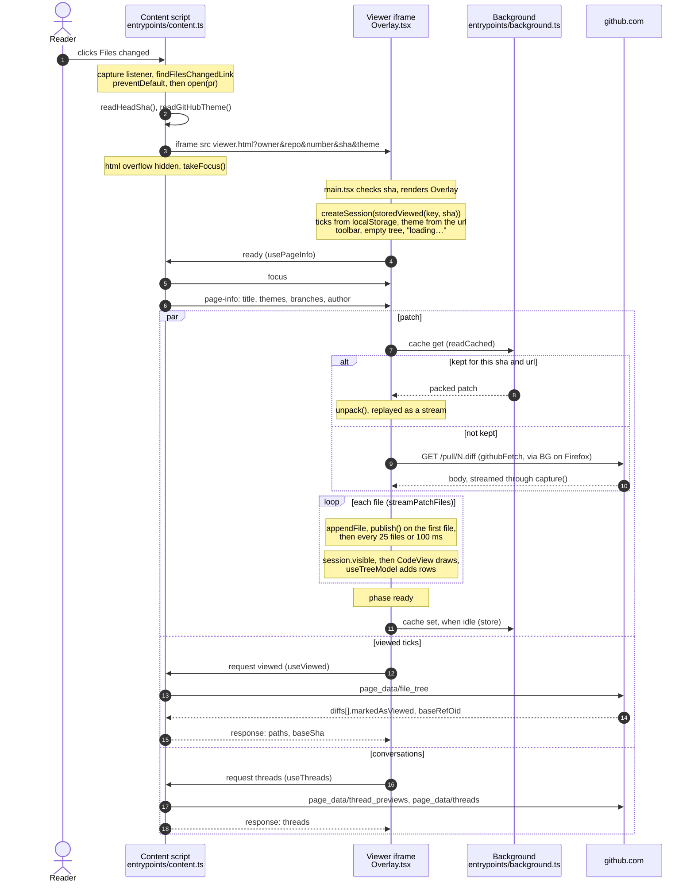
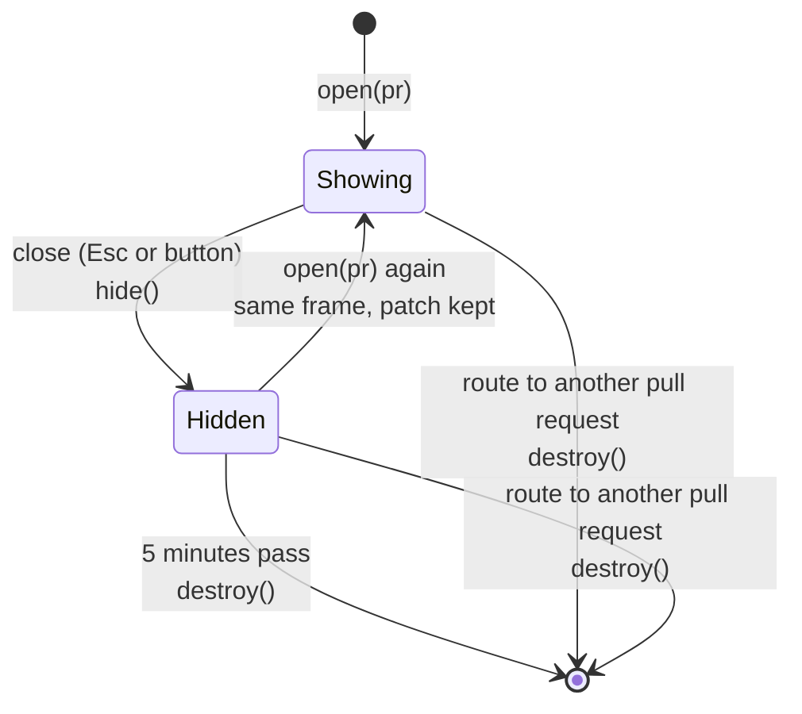

# Lifecycle

What happens from a click on "Files changed" to the first file on screen, and
what happens when the viewer is closed. Each step names the function that does
it.

## Opening

The three requests after `ready` do not wait for each other. The first file
usually shows before the ticks or the conversations arrive, and each lands
on the diff when it comes.

| When | What is on screen |
| --- | --- |
| Click | The iframe, empty, over the page |
| First render | Toolbar, empty tree, "loading…", in the theme from the url, with the ticks kept in this browser |
| `page-info` | The title and GitHub's own theme names |
| First file parsed | The first file and its tree row; highlighting follows from the workers |
| Every 25 files or 100 ms | More files and rows |
| Patch ends | "loading…" goes, `data-dh-phase="ready"` |
| `viewed` answers | GitHub's ticks replace the kept ones, unless the reader ticked something meanwhile |
| `threads` answers | Conversations at their lines |

## Closing and coming back

A frame that was destroyed is built again on the next open. The patch then
comes from the cache when the page is on the same commit (`docs/caching.md`).
